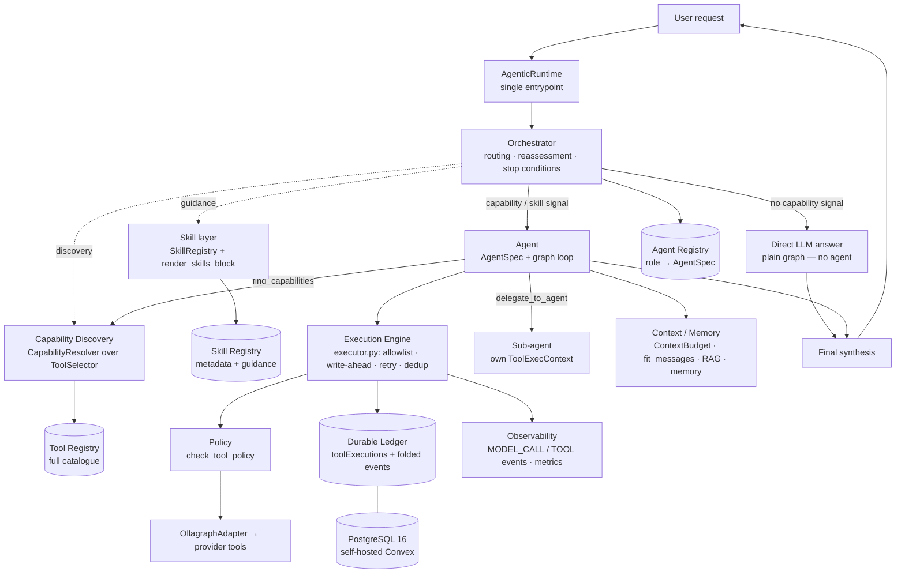
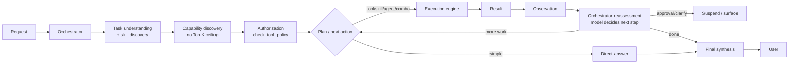

# OllaSuper Agentic Runtime — Architecture

The final reference for the 0–12 phase agentic program. It is a **design document**
(the house status record stays in `ROADMAP.md`). It describes the integrated
runtime built across Phases 1–12: an all-rounder agentic AI runtime that scales its
reasoning to the task, reaches any capability without an arbitrary Top-K ceiling,
executes durably, and is fully observable — assembled from small, separable
contracts rather than one giant prompt/agent/tool-list/executor.

> **Honest status (read first).** The **durable execution engine (Phases 1–8) is
> live** in `app/runtime/runner.py` (production chat). The **agent, orchestrator,
> dynamic capability-resolution, and skills (Phases 9–11), and the integrated
> `AgenticRuntime` (Phase 12), are built and fully test-proven but not yet wired
> into the live streaming path** — see [Known limitations](#known-limitations--external-provider-dependencies).
> This document does **not** claim production-readiness for the orchestrated path.

---

## 1. Architecture diagram

The layers are the contract: **LLM + Orchestrator + Capability Discovery + Skills +
Agents + Tools + Durable Execution Engine + Policy + Memory/Context +
Observability** — each a separate module with a guarded seam, never a monolith.

---

## 2. Execution lifecycle

**Complexity scales to the task.** A simple request (`"capital of France"`) has no
capability signal → a direct LLM answer, no agent built. A complex request
(`"research competitors, compare pricing, write a report"`) fans out: understand →
discover research/web tools → execute searches → observe → discover more (mid-run
`find_capabilities`) → analyze → compose a report → synthesize — and can change
course on intermediate results. The adaptive loop lives in the agent graph (the
model reassesses each step); the orchestrator adds routing, delegation, parallel
branches, and the stop conditions.

**Stop conditions (never "call tools because it can"):** completion · user cancel ·
policy denial · approval unavailable / required · clarification required ·
unrecoverable failure · budget exhausted (per-agent `max_steps` +
`max_orchestration_steps` + total deadline).

---

## 3. Component boundaries (who owns what)

| Component | Module | Owns |
|---|---|---|
| Execution engine | `app/agent/executor.py` | the strict allowlist, write-ahead, retry, dedup, approval park, injection framing — the ONLY place a tool runs |
| Agent graph | `app/agent/graph.py` | the model↔executor adaptive loop; dynamic re-bind |
| Agent unit | `app/agent/base.py`, `spec.py` | `AgentSpec` (declarative) + `Agent` runtime → `AgentResult` |
| Orchestrator | `app/orchestrator/orchestrator.py` | routing, delegation, parallel, stop conditions |
| Capability discovery | `app/orchestrator/capabilities.py`, `app/tools/selection.py` | full-registry ranking, auth annotation |
| Skills | `app/skills/` | `SkillManifest`, discovery, bounded trusted composition |
| Policy | `app/agent/policy.py`, `app/tools/classify.py` | `check_tool_policy`; side-effect classification |
| Context/Memory | `app/agent/budget.py`, RAG/memory built-ins | window budgeting, compaction, retrieval |
| Persistence/Recovery | `convex/chat/executions.ts`, `chat/events.ts` | durable ledger, resume authority |
| Observability | events + `AgentResult`/`OrchestratorResult` | reconstructable trace |
| Integration | `app/runtime/agentic.py` | `AgenticRuntime` — the single composition |

Each upper layer is **guarded**: with no resolver/delegator/skills attached, the
lower layers behave byte-identically (the reason 65 Phase 1–9 tests are unchanged by
Phases 10–11).

---

## 4. Capability model
- **Registry:** every discovered provider operation is a `ToolDefinition` in the
  `ToolRegistry` (the full catalogue).
- **Discovery ≠ authorization ≠ execution** (three separate layers). Discovery
  (`CapabilityResolver`) ranks the **whole** registry for a query and annotates each
  match with its `check_tool_policy` status — it never filters by permission and
  never executes.
- **No Top-K reachability ceiling.** The initial working set is a small inlined
  slice (`ai_capability_working_set`); the model reaches anything else via the
  `find_capabilities` built-in, which searches the full registry and **dynamically
  loads** matches — updating BOTH the model's bound specs and the executor's strict
  allowlist — so a tool ranked #6 becomes callable in the same run. Context stays
  bounded because only the working set + discovered matches are inlined.

## 5. Agent model
- **`AgentSpec`** (declarative): identity, role, instructions (static persona),
  capability / context / execution / output policy. Same LLM backs many agents.
- **`Agent`** (stateless runtime): builds the scope + `ToolExecContext` + graph from
  the spec, runs it, and maps the terminal state to a structured `AgentResult`
  (`FINAL_ANSWER` / `FINDINGS` / `STRUCTURED_RESULT` / `NEXT_ACTION` /
  `NEEDS_CAPABILITY` / `NEEDS_CLARIFICATION` / `FAILURE`).
- **Composition:** the orchestrator delegates to specialized sub-agents
  (`delegate_to_agent`, own execution context, bounded depth) and runs parallel
  branches. An agent can only **narrow** what the engine permits.

## 6. Skill model
- **`SkillManifest`:** discovery metadata (purpose / when_to_use / tags) **separate**
  from full guidance (methodology / instructions / constraints / output) loaded ONLY
  on activation — the reason 5 or 500 skills cost the same per request.
- **Discovery is tag-anchored** for precision; composition is **bounded** (top-N +
  char budget, whole skills dropped to fit).
- **Trust boundary:** skill guidance is injected as a `<skill_guidance>` **trusted**
  block — the mirror of the untrusted `<tool_output>` frame. A skill may `require_
  approval` (**tighten** only) and `preferred_capabilities` (seed the working set),
  but can NEVER bypass a gate. No agent is created per skill; the orchestrator holds
  no skill-id branches.

## 7. Tool model
- **`ToolDefinition`:** normalized provider-agnostic metadata (side-effect class,
  permissions, timeout, idempotency support).
- **Strict allowlist:** only tools *resolved this turn* (`name_to_tool_id`) are
  callable; a hallucinated or out-of-policy name is refused as unknown.
- Every call: allowlist → `check_tool_policy` → write-ahead → adapter, bounded
  result, injection-framed on re-entry.

## 8. Persistence model
- **PostgreSQL 16** (self-hosted Convex, `--db postgres-v5`) holds documents, index
  data, scheduler/cron; compiled modules + search indexes stay on the docker volume.
- **`toolExecutions`** (a Convex table) is the durable per-execution recovery
  authority; typed events fold into `chatMessages.events` at finalize as the
  post-hoc trace. The in-flight assistant row is written exactly twice (insert +
  finalize) — streaming rides append-only delta/event channels.

## 9. Recovery model
- **Write-ahead:** a side-effecting call fires only after its intent durably lands
  (dual gate: the `toolExecutions` row OR the TOOL_CALL event). If neither lands, it
  ABORTS — an unrecorded side effect is never issued.
- **Resume:** on crash-resume, completed tools are rebuilt from the durable log and
  their idempotency keys re-seeded, so **completed side effects are not re-run**;
  attempted-but-ambiguous tools are injected as INDETERMINATE and never retried.
- **At-most-once, not exactly-once** — see limitation #2.

## 10. Security model
- **Model output is never an execution/security authority.** Every safety decision
  is code: `check_tool_policy` (ALLOW / NEEDS_APPROVAL / DENY), the strict allowlist,
  default-closed side-effect classification (`classify.py`), default-closed input
  validation.
- **Authorization identity** (`PolicyScope`: user / workspace / tenant / agent_id) is
  threaded from the authenticated request, never the model.
- **Approval is authoritative + all-or-pause:** any fresh approval pauses the whole
  assistant action; no sibling runs; the decision is a Convex field, not process
  memory.
- **Prompt injection** is contained by construction: untrusted tool/web/RAG output is
  framed as `<tool_output>` DATA; skill guidance is a distinct `<skill_guidance>`
  trusted frame; neither the model's reading of text nor a poisoned result can change
  a gate.

## 11. Observability model
- Every agent run emits typed **MODEL_CALL** (decision + tokens + duration + provider
  id, agent-attributed) and **TOOL_CALL / TOOL_RESULT** events carrying the execution
  identity + lifecycle state + metrics. Secrets are shape-redacted at the emit edge;
  the transient recovery record stays exact.
- **A workflow is reconstructable from the ledger:** the ordered folded events + the
  message metrics answer "what the execution state machine recorded." Orchestration
  decisions (route / delegation / active skills + versions) ride `OrchestratorResult`
  + logs (a durable Convex ROUTE/SKILL event is deferred).

---

## Test results

| Suite | Result |
|---|---|
| AI plane — `uv run ruff check .` | clean |
| AI plane — `uv run pytest` | **437 passed, 11 skipped** |
| — Phase-12 E2E (`test_runtime_e2e.py`) | 21 tests (all 22 acceptance scenarios) |
| Convex — `bun run test` | 192 passed, 1 skipped |
| Monorepo — `bun run typecheck` | 7/7 |

The E2E suite drives every acceptance scenario through `AgenticRuntime.run` /
`run_parallel` (simple · tool · multi-tool · parallel · failure→retry · ambiguous
side-effect · approval · cancel · recovery · agent · multi-agent · skill ·
multi-skill · combined · dynamic-discovery-outside-top-5 · scale (50 skills / 100+
tools) · context · security · prompt-injection · cost/loop).

---

## Known limitations & external-provider dependencies

1. **Not wired to the live path.** The orchestrated runtime (skills / dynamic
   discovery / multi-agent) is proven by tests but does not serve production traffic;
   the live chat still runs the Phase 1–8 loop with `ai_agent_discovery_top_k = 5`.
   Wiring requires the **invoke→stream integration** (the runner streams via
   `graph.astream`; `Agent`/`Orchestrator` use `graph.ainvoke`) — decide how the
   orchestrated final synthesis and multi-agent sub-runs stream to the writer — plus
   **production headed-Chrome verification** and a deploy go-ahead.
2. **At-most-once, not exactly-once (Ollagraph dependency).** Provider-deduplicated
   retries need the provider to honor an idempotency key; Ollagraph declares none, so
   an AMBIGUOUS outcome (timeout / 5xx / transport / unreadable 2xx) on a
   non-idempotent side-effecting tool is recorded **INDETERMINATE** and never
   auto-replayed — an honest "unknown", not a 0-or-1 guarantee.
3. **Durable recovery depends on Convex (external store).** The ledger on self-hosted
   Postgres is the recovery authority; if Convex is unreachable the write-ahead
   **aborts** a side-effecting call (fail-safe), so the exposure is availability, not
   silent loss or double-fire.
4. **Model provider dependency (Ollima / OpenRouter).** Generation, routing, skill
   selection, and tool choice depend on provider availability, latency, and token
   limits; the total-execution deadline + step/budget caps bound the blast radius but
   cannot make an unavailable provider available.
5. **Model behavior is not an authority.** All routing/selection is best-effort;
   safety never depends on it. Prompt-injection safety is by framing + trusted-config
   + code gates, not by trusting the model.
6. **`--workers 1`** (single event loop) is the correctness precondition for the
   concurrency-safety invariants (await-free dedup, monotonic event seq).
7. **Context budgeting in the orchestrator path is heuristic** (char/count caps);
   full window-aware `ContextBudget` measurement is wired only in the runner today —
   folding it into the orchestrated path is part of productionization.
8. **Orchestration observability** (route / delegation / skill activation) is not yet
   a durable Convex event; it rides `OrchestratorResult` + logs.

The system is a genuinely extensible, reliable, all-rounder agentic runtime **as
demonstrated by the test suite**; making the orchestrated path the live production
runtime is the remaining, honestly-scoped productionization step (limitation #1).
